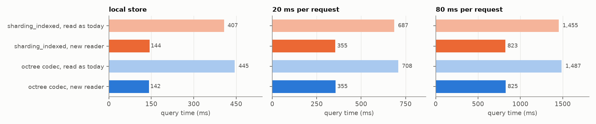

# zarr-octree

Zarr stores every chunk of its regular grid as a separate object, so object
sizes follow the density of the data: thousands of near-empty objects in
sparse regions, huge ones in dense regions.  zarr-octree groups neighbouring
chunks, along an octree's Z-order, into objects of bounded size, without
changing the chunk grid zarr sees.  It is a sharding codec,
`zarr_octree_sharding`, that unmodified zarr-python loads through its codec
entry point, plus an experimental store extension.  Built for point clouds in
zarr-vectors (option 1 of AllenInstitute/zarr-vectors-py#45).

## Octree against constant chunks


With constant chunks, every chunk is an object however many points it holds.
An octree splits a node into eight only while it holds too many points, so a
node covers a large volume where the data are sparse and a small one where
they are dense, and empty space costs nothing.  An octree bounds size from
above only — a sparse node beside a dense one stays small — so zarr-octree
also merges neighbouring small nodes along the Z-order into **runs** between a
minimum and a maximum size.  (Synthetic points: three clusters with broad
tails, 2.27 M points; `bench/figures_concept.py`.)

## Results

* **Even objects.**  On a 3.99 M-point synthetic cloud, runs bounded at
  4k–16k vertices all hold 4,055–15,999 vertices (coefficient of variation
  0.28); uniform grids spread over 4–6 orders of magnitude (CV 4.7–15).
* **Smaller stores.**  The codec's sparse index (6 bytes per stored chunk,
  against 16 bytes per *possible* chunk) makes the zarr-vectors store 12 %
  smaller (48.2 against 55.1 MB); more on sparse data.
* **Speed comes from the reader, not the format.**  zarr-vectors today reads
  every sharded cell through zarr, which re-reads the shard's index each
  time.  A reader that reads each index once and merges neighbouring byte
  ranges halves query time at 20 ms latency — on either format.  With that
  reader, octree runs and plain `sharding_indexed` are equal.



Geometric mean over 10 query types (boxes and objects) on the 3.99 M points
written through zarr-vectors, 16³-cell shards, 100 MB/s per request.  "New
reader": each shard index read once, neighbouring byte ranges merged.

So the octree is worth having for **store size** and for consumers that work
in **bounded units** (GPU batches, BRIDGE graphs: `read_runs`), not as a
speed-up on its own.  Through zarr's own per-chunk reads no layout beats
coarse constant chunks, as zarr's per-chunk work dominates.  Every benchmark,
figure and number is in [`bench/RESULTS.md`](bench/RESULTS.md).

## Using it

The codec (`pip install -e .`; anyone reading the array needs the package too
— without it zarr refuses the array as an unknown codec):

```python
import zarr
from zarr.codecs import BytesCodec, ZstdCodec
from zarr_octree.codec import OctreeShardingCodec

codec = OctreeShardingCodec(chunk_shape=(16, 16, 16), codecs=[BytesCodec(), ZstdCodec()],
                            min_weight=16_000, max_weight=64_000)   # runs of 16–64 kB
arr = zarr.create_array("data.zarr", shape=(256, 256, 256), chunks=(128, 128, 128),  # chunks = shard shape
                        serializer=codec, compressors=None, dtype="float32", fill_value=0)
arr[:] = ...                                   # any zarr reads and writes
```

Run bounds are in encoded bytes, or in any unit with a registered weigher
(`register_weigher("vertices", fn)`, then `unit="vertices"`).

The store extension (experimental: zarr-python rejects arrays with storage
transformers, so the store hides its own from zarr, and a store without the
extension refuses the array):

```python
import zarr
from zarr.storage import LocalStore
from zarr_octree import OctreeConfig, OctreeStore

config = OctreeConfig(max_depth=5, min_weight=16_000, max_weight=64_000)
store = OctreeStore(LocalStore("points.zarr"), arrays={"pts": config})
arr = zarr.create_array(store, name="pts", shape=(32, 32, 32), chunks=(1, 1, 1), dtype="bytes")
arr.vindex[...] = ...                          # any zarr writes
store.flush()                                  # pack buffered writes into runs
```

## How the codec stores a shard

The array, its shards, inner chunks and keys are what `sharding_indexed`
gives; only the bytes inside a shard differ (format in [`SPEC.md`](SPEC.md)):

* inner chunks in Z-order, contiguous, grouped into runs bounded by
  `min_weight` / `max_weight`;
* a **sparse index**: one row per stored chunk (a Z-order code and a length;
  offsets are implied) plus the run table, fetched with one suffix read;
* partial reads fetch **one byte range per run touched**; `read_runs` hands
  whole runs to consumers that want bounded units.

## Status

* 43 tests (`pytest`), passing on zarr 3.4.0 and 3.2.1.
* The codec subclasses zarr's `ShardingCodec` and uses some of its private
  internals, so new zarr releases need testing.
* The format is not frozen (checksum, index position).
* In zarr-vectors the codec and the new reader live on a local branch
  (`octree-sharding-proto`) behind environment variables; nothing is
  upstream yet.
* Not done: concurrent writers, atomic updates, tests on real object stores.

## Files

```
src/zarr_octree/codec.py       the zarr_octree_sharding codec
src/zarr_octree/tree.py        Morton codes, run partition, node and manifest formats
src/zarr_octree/store.py       the store extension (OctreeStore, convert)
src/zarr_octree/instrument.py  counting / latency store for tests and benchmarks
tests/                         pytest
bench/make_points.py           the synthetic densMAP point cloud
bench/bench*.py, figures*.py   benchmarks and their figures; results in bench/RESULTS.md
bench/figures_concept.py       the figure above
SPEC.md                        on-disk formats
```
