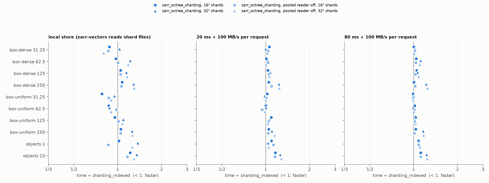
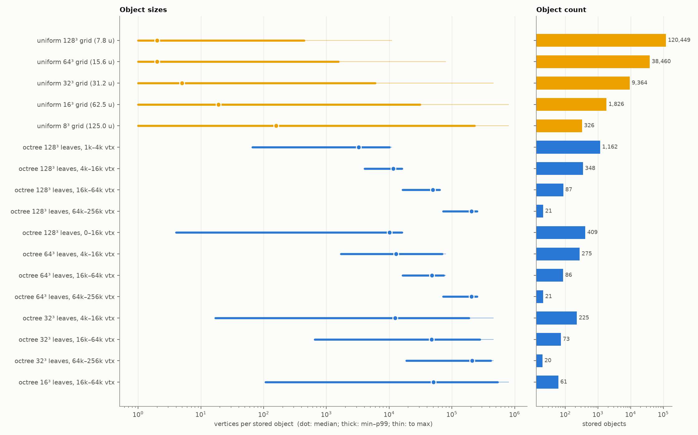
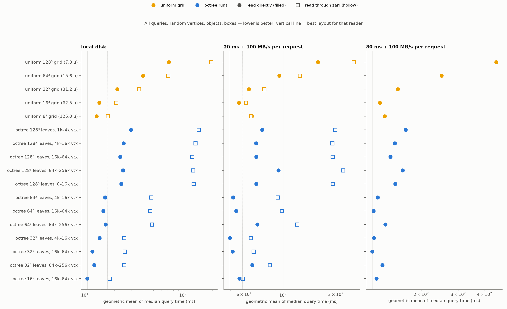
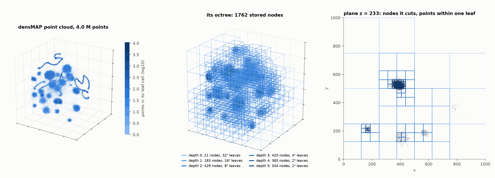
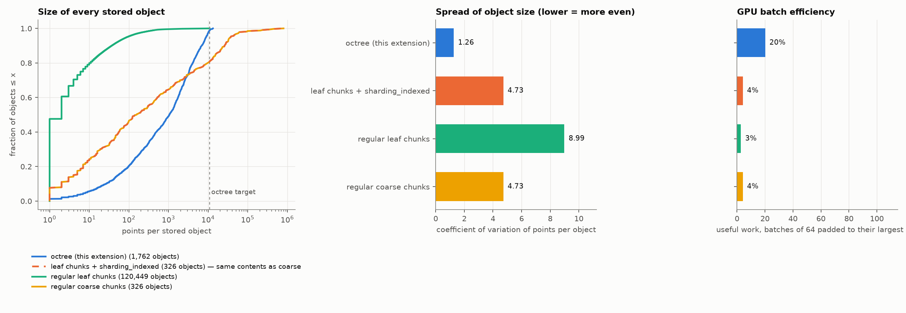
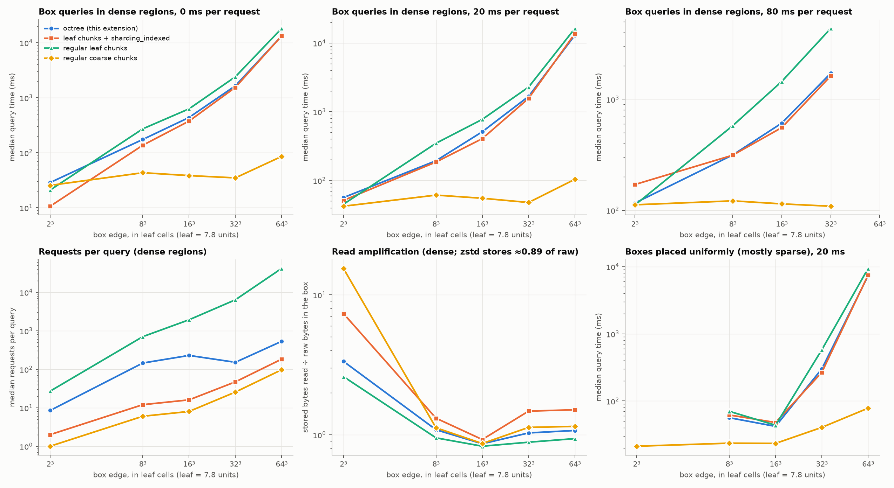
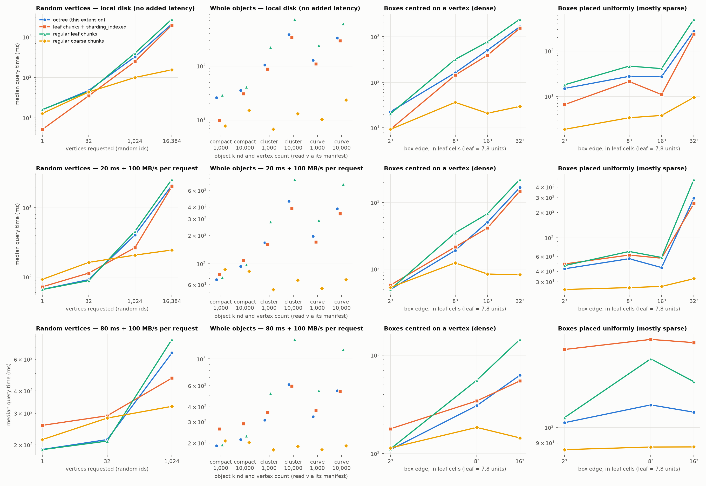
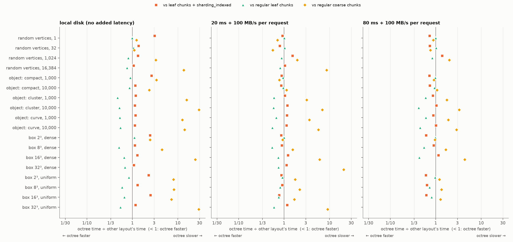

# zarr-octree

Octree chunk packing for Zarr v3, as a store-layer extension.  Zarr — and
anything built on it, such as zarr-vectors — keeps seeing an ordinary array on
a regular chunk grid.  Underneath, the chunks are grouped into objects sized by
their content, between a minimum and a maximum weight (bytes, or vertices):
runs of the octree's Z-order, cut on the coarsest octree boundaries the bounds
allow — few chunks per object where the data are dense, many where they are
sparse.  Option 1 of the octree-chunking proposal
(AllenInstitute/zarr-vectors-py#45), built and tested only as a standalone
Zarr extension; nothing here depends on zarr-vectors.

The on-disk format is in [`SPEC.md`](SPEC.md).

```python
import zarr
from zarr.storage import LocalStore
from zarr_octree import OctreeConfig, OctreeStore

config = OctreeConfig(max_depth=5, min_weight=16_000, max_weight=64_000,   # objects of 16k–64k vertices
                      unit="vertices", weigh=count_vertices)              # weigh(encoded chunk) -> vertices
store = OctreeStore(LocalStore("points.zarr"), arrays={"pts": config})
arr = zarr.create_array(store, name="pts", shape=(32, 32, 32), chunks=(1, 1, 1), dtype="bytes")
arr.vindex[...] = ...          # any zarr writes
store.flush()                   # pack buffered writes into nodes (or use `with store:`)

store = OctreeStore(LocalStore("points.zarr"))
arr = zarr.open_array(store, path="pts")      # any zarr reads
store.get_cells("pts", [(3, 4, 5), ...])      # optional: encoded chunks fetched node-wise, without zarr
```

Without `unit`/`weigh` the bounds are in encoded bytes.

A store without the extension refuses the array (`MetadataValidationError`)
instead of silently reading it as empty: zarr-python ignores
`storage_transformers`, so the metadata also carries a `must_understand` field.
`convert(source, path, target, config)` copies an existing regular array.

## How it works

* **Keys.** Chunk keys `pts/c/i/j/k` never exist in storage.  Nodes live at
  `pts/o/<depth>/i/j/k` — named by the octree block each starts at — plus one
  manifest `pts/o/manifest` listing every node with its first and last
  occupied Z-order code.
* **Partition.** Within each root (`2^max_depth` chunks per axis), the
  occupied chunks in Z-order are cut into runs weighing `min_weight` to
  `max_weight`, each cut on the coarsest octree boundary available.  Pure
  octree nodes (format 1) can only bound size from above — a sparse block
  next to a dense sibling stays small — so format 2 merges siblings along the
  Z-order.  A single chunk heavier than `max_weight` is a node of its own.
* **Reads.** The manifest resolves a chunk key to its node — or to "empty"
  with no request.  A node is fetched once per query however many of its
  chunks are asked for (concurrent requests share one fetch), and cached.
  `get_cells` returns encoded chunks node-wise without zarr's per-chunk work.
* **Writes.** Buffered in memory, then packed per root: an edit rewrites only
  the nodes whose ranges it touches; one that grows a node past `max_weight`
  re-cuts that root.  `repack()` re-merges after deletions.
* **Anything else passes through**: other arrays, groups, attributes; sharded
  arrays inside an octree array (byte-range reads are served from the chunk).

## Tests

`pytest` — 35 tests, all passing on **zarr 3.4.0 and 3.2.1**.  They go through
zarr's public API only: round trips of vlen point cells and of numeric arrays
(2-D, 3-D, 4-D; `/` and `.` separators; multi-cell chunks; sharded chunks),
edits (overwrite, delete, add in empty space, growth past the target),
reads of buffered writes, read-only views, metadata rewrites (attrs, resize)
keeping the extension, listing equal to a regular store's, `convert`,
overwrite, auto-flush, plain zarr refusing the array, one storage request per
node, the min/max bounds in bytes and in a custom unit (vertices), `get_cells`
against zarr, Morton codes, and the partition invariants (each cell in exactly
one node, runs contiguous and cut on octree boundaries).

```
~/.conda/envs/shapetensors/bin/python -m pytest -q      # zarr 3.4.0
~/.conda/envs/zarr-vectors/bin/python -m pytest -q      # zarr 3.2.1
```

## Prototype B: `zarr_octree_sharding`, a sharding codec (tested in zarr-vectors)

`src/zarr_octree/codec.py` is the smallest-footprint form of the same idea: a
codec in place of `sharding_indexed`, so zarr-python needs **no change** — it
finds the codec through the `zarr.codecs` entry point, and a reader without
it refuses the array (unknown codec).  The array, its shards, inner chunks and
keys are what `sharding_indexed` gives; only the bytes inside a shard differ:

* a **sparse index** (one row per stored inner chunk, ~28 B) instead of the
  dense one (16 B per *possible* inner chunk);
* inner chunks in Z-order, grouped into **runs** bounded by `min_weight` /
  `max_weight` (`build_runs`, as in format 2), listed in the index;
* partial reads fetch **one byte range per run touched**, concurrently;
  `read_runs` hands whole runs to a consumer that wants bounded units.

It subclasses zarr's `ShardingCodec`, so `Array.shards`/`chunks` and code on
zarr's sharding API (zarr-vectors' range reads, shard transactions) work
unchanged; it opts out of zarr 3.4's synchronous sharding path, which assumes
the dense index.  7 tests (`tests/test_codec.py`), zarr 3.4.0 and 3.2.1.

**In zarr-vectors** (local branch `octree-sharding-proto`, worktree
`~/scripts/zarr-vectors-py-octree`, 91 lines in three internal files, no API
change): `Group.create_sharded_chunk_array` builds this codec when
`ZARR_VECTORS_SHARD_CODEC=zarr_octree_sharding` (a prototype switch); the
pooled local cell reader reads the sparse index; "is it sharded?" accepts any
`ShardingCodec`.  zarr-vectors' suite with the codec forced on for every
sharded array: 2,092 passed, 18 failed — against 2,109 / 1 for the baseline.
After the sharded-detection fix the codec accounts for 5: four tests assert
the codec name `sharding_indexed`, one corrupts a dense index and expects
zarr's crc32c message.  (One failure is in the baseline too; one is the
worktree lacking the generated `_version.py`.)

`bench/bench_zv.py` (figures: `bench/figures_zv.py`) writes the 3.99 M
densMAP points through zarr-vectors (64³ cells, zstd; objects of ~1,000
vertices), sharded 16³ or 32³ cells per shard by either codec (runs
160–640 kB), and reads boxes and objects through zarr-vectors' API — locally,
and behind the latency store (20 / 80 ms + 100 MB/s per request).  Every
store returns the same points for every query.



| | `sharding_indexed` 16³ | octree 16³ | `sharding_indexed` 32³ | octree 32³ |
|---|---:|---:|---:|---:|
| store size (MB) | 55.1 | **49.6** | 56.1 | **49.6** |
| write (s) | 42.2 | 43.0 | 48.6 | 48.4 |
| query geomean, local (ms) | 440 | **430** | **412** | 471 |
| query geomean, 20 ms (ms) | **682** | 720 | **705** | 758 |
| query geomean, 80 ms (ms) | **1,458** | 1,509 | **1,476** | 1,603 |

* **Disk −10 %** (−39 % on a 400k-point subset, where shards are sparser):
  the dense index of a 16³ shard is 64 KiB however little it holds.
* **Queries: no gain, 2–8 % slower with 16³ shards, up to 9 % with 32³.**
  zarr-vectors reads cell by cell — the pooled local reader one byte range
  per cell, the object-store path one range request per cell — so the runs
  never become the unit of a read, and requests per box are identical.  The
  octree codec loses where (a) a dense shard's sparse index outgrows the
  64 KiB first read (4 of 112 shards at 16³, 10 of 16 at 32³: a second
  request), and (b) objects scattered within a run make its span over-read
  (10-object queries: 265 vs 211 MB at 16³).
* What it would take to gain: a zarr-vectors reader that fetches runs
  (`read_runs`) — the bounded units the BRIDGE argument is about — and an
  index read sized to the shard (or the index at the start of the shard).
  As a drop-in for `sharding_indexed` under today's readers it buys disk,
  not speed.

## Chunk layouts compared: bounded octree runs against uniform grids

`bench/bench_bounds.py` (figures: `bench/figures_bounds.py`) stores the same
3.99 M densMAP points (below) as five **uniform grids** — 128³ to 8³ chunks,
7.8 to 125 units wide — and twelve **octree-run layouts**: a 128³, 64³, 32³ or
16³ leaf grid packed into runs bounded in vertices (`unit="vertices"`).  Each
layout is read two ways: **through zarr** (`arr.vindex`, as zarr-vectors
reads today), and **directly** (chunks or nodes fetched concurrently and
decoded here, octree via `get_cells`) — what the layout costs without zarr's
per-chunk work.  Queries: random vertices (1–16,384), whole objects (compact
/ cluster / curve, 1k and 10k vertices) and boxes (15.6–250 units, dense or
uniformly placed), 5 each; vertex addresses are looked up in memory (the
same for every layout), only the vertex reads are timed, and every result is
checked against the source.  Latency: none, or 20 / 80 ms plus 100 MB/s per
request, 128 requests in flight.



**The bounds hold where the leaf allows.**  With 128³ leaves and 4k–16k
vertices, all 348 objects hold 4,055–15,999 vertices (CV 0.28); uniform grids
range over 4–6 orders of magnitude (CV 4.7–15).  A leaf chunk cannot be
split, so with coarser leaves the maximum is the densest leaf (457k vertices
for 32³ leaves) — the leaf size is the floor of the size control.



Geometric mean over all 17 query families of the median time (ms); best of
each kind:

| reader | latency | best uniform | best octree runs | octree 32³ leaves, 16k–64k |
|---|---|---|---|---|
| direct | local | 13 (8³) | **11** (16³, 16k–64k) | 12 |
| direct | 20 ms | 56 (16³) | **50** (32³, 4k–16k) | 52 |
| direct | 80 ms | 127 (16³) | **117** (32³, 16k–64k) | **117** |
| zarr | local | **17** (8³) | 18 (16³, 16k–64k) | 25 |
| zarr | 20 ms | 61 (16³) | **59** (16³, 16k–64k) | 68 |

* **Read directly, bounded runs beat every uniform grid**, by 8–15 %, and
  one configuration stays near the top everywhere: 32³ leaves with
  16k–64k-vertex runs is within 12 % of the best layout at every latency,
  while the best uniform grid changes with latency (8³ locally, 16³ with
  latency) and is up to 33 % off the best somewhere.  Per query family (20 ms)
  it wins most on scattered and mid-size reads — 32 random vertices 0.68×,
  1,024 0.78×, 10k-vertex compact objects 0.75×, 62–125-unit dense boxes
  0.75× — and loses up to 15 % on sparse boxes and small cluster objects,
  where a run can reach beyond the box and read more than a 62-unit chunk.
* **Through zarr it is a tie**: the best runs (16³ leaves, 16k–64k) are
  within 5 % of the best layout at both latencies, the best uniform grid
  within 11 %.  Zarr's per-chunk cost (~0.3 ms) still rewards coarse leaves,
  which is why 128³-leaf runs are 3–7× slower than the 16³–32³ ones through
  zarr, but only 1.2–2.4× slower when read directly.
* **Small leaves pay for themselves only up to a point**: 128³ leaves give the
  tightest objects but every query touches many leaf chunks, each a separate
  zstd frame to decode.  The optimum here is 32³ leaves (31 units) packed
  into 16k–64k-vertex runs.
* 4k–16k and 16k–64k are within 5 % of each other at every leaf size (4k–16k
  ahead at 20 ms, 16k–64k locally and at 80 ms); 64k–256k reads too much per
  object, 1k–4k makes too many.

So yes: a bounded configuration is more efficient than any uniform chunking —
modestly (≈10 %) on time, much more on object-size evenness (CV 0.3–1.1 against
5–15) and robustly across latencies — but only for a reader that takes nodes
(`get_cells`).  Through zarr's chunk API the leaf grid is what zarr pays for,
and the best uniform grid is as good.

The sections below are **format 1** (whole octree nodes, a byte target, no
minimum; commit `5bf1110`): they compare four layouts through zarr only.

## Benchmark

`bench/make_points.py` makes a synthetic point cloud with strongly varied
density: a 40-D mixture (24 Gaussian clusters with power-law sizes and spreads,
three curved 1-D manifolds, uniform background) embedded in 3-D with
**densMAP** — UMAP evens out local density, densMAP keeps it — then resampled
to **3.99 M points** in a 1000-unit box.  Binned on a 128³ grid of leaf cells
(7.8 units), 120,449 cells are occupied; the median holds 2 points, the
densest 10,927.

`bench/bench.py` stores the same points four ways, as zarr-vectors stores
vertices (one vlen-bytes chunk of float32 xyz per cell, zstd):

| layout | chunk zarr sees | stored object |
|---|---|---|
| coarse | 16³ leaves | one per coarse chunk |
| leaf | 1 leaf | one per leaf |
| sharded | 1 leaf | `sharding_indexed`, one shard per 16³ leaves |
| **octree** | 1 leaf | one per node: `max_depth=5` (root 32³ leaves), `target_bytes=128 KiB` |

Queries are boxes from 2³ to 64³ leaves, centred on random points ("dense")
or uniformly ("uniform", mostly sparse), reading only the occupied cells (as
zarr-vectors does with `nonempty_chunks`) with `arr.vindex`.  Every store sits
on a counting store that adds 0, 20 or 80 ms to each request, with at most 128
requests in flight (an object-store client's connection pool); zarr may issue
4,096 chunk requests at once.  `bench/results/bench_zarr_default.*` repeats
the run with zarr's default 128 chunk requests and no in-flight cap.



### Object sizes — the motivation in #45



| | objects | median points | max points | max / median | CV | disk ÷ leaf layout |
|---|---:|---:|---:|---:|---:|---:|
| coarse | 326 | 158 | 801,109 | 5,070 | 4.73 | 0.96 |
| leaf | 120,449 | 2 | 10,927 | 5,464 | 8.99 | 1 |
| sharded | 326 | 158 | 801,109 | 5,070 | 4.73 | **1.50** |
| **octree** | **1,762** | 1,055 | **13,238** | **12.6** | **1.26** | 1.06 |

The octree caps every object at about the target (the max is one leaf at the
deepest level, slightly over the target in raw points because the target is
in compressed bytes), with 1/70 the objects of leaf chunks.  Sharding stores a
dense 16-byte index entry per inner chunk — 64 KiB per shard, empty cells
included — which here is half as much again as the data.  The GPU batch proxy
(64 objects padded to the largest) rises from 3–4 % to 20 %: better, but
small sibling nodes left by splits still pad badly (see below).

The sweep (`figures/sweep.png`) shows 64–256 KiB as the evenness optimum for
this data; depth beyond 5 changes nothing here because every 64³-leaf block
exceeds 1 MiB.

### Queries through zarr



Median ms, coarse / leaf / sharded / **octree**:

| per request | placement | 8³ box | 16³ box | 32³ box | 64³ box |
|---|---|---|---|---|---|
| 0 ms | dense | 43 / 272 / 137 / **174** | 38 / 628 / 376 / **437** | 35 / 2,401 / 1,540 / **1,645** | 86 / 18,160 / 13,296 / **13,239** |
| 20 ms | dense | 61 / 347 / 185 / **193** | 55 / 774 / 405 / **511** | 48 / 2,279 / 1,564 / **1,668** | 104 / 16,267 / 13,689 / **12,970** |
| 80 ms | dense | 121 / 578 / 313 / **315** | 114 / 1,446 / 555 / **609** | 109 / 4,343 / 1,621 / **1,713** | — |
| 80 ms | uniform | 83 / 151 / 180 / **116** | 84 / 104 / 168 / **103** | 103 / 1,051 / 408 / **406** | — |

* **Octree ≈ sharding** among the layouts that keep leaf-sized chunks for
  zarr.  With latency (20, 80 ms) they are within about 25 % of each other;
  the octree is ahead on small and sparse boxes at 80 ms (one round trip —
  the manifest is already loaded — against sharding's two: shard index, then
  ranges; 116 vs 170 ms for a dense 2³ box) and behind on mid-size dense
  boxes, where zarr coalesces a shard's byte ranges into a few requests while
  128 KiB nodes need more (142 vs 12 requests for a dense 8³ box).  With no
  latency the octree is up to 2.6× slower on small boxes (29 vs 11 ms for a
  dense 2³ box): it reads and decodes a whole node where sharding reads only
  the chunks' byte ranges.  Both beat plain leaf chunks by 2–3× in dense
  regions.
* **Coarse chunks are fastest at every latency**: 1.4× (sparse 8³ box,
  80 ms) to 150× (dense 64³ box) ahead of all three.  The cost of a
  leaf-chunked query is zarr's own per-chunk work — about 0.3 ms per chunk to
  schedule, decode and assemble — not I/O: a 64³ dense box is ~40k chunks for
  zarr whatever the storage does.  An extension below zarr cannot remove that
  cost; it is the price of zarr seeing leaf-sized chunks.
* Plain `arr[box]` slicing (zarr asks for every chunk, empty or not) and a
  cold open + first query are in `figures/slice_and_cold.png`; the octree
  answers empty chunks from the manifest without requests, and its cold start
  is one manifest read more than sharding's.
* Build (write through zarr + pack): octree 30 s, leaf 87 s, sharded 168 s.

## Spatial and vertex-index queries

`bench/bench_index.py` (figures: `bench/figures_index.py`) reads the same
stores the way zarr-vectors addresses vertices — as (chunk, row) — and adds a
transfer time to the injected latency (100 MB/s per request), so a large
chunk costs more than a small one.

* **random vertices**: `k` vertex ids, looked up in a dense address table
  (65,536 rows per chunk), then their chunks fetched;
* **whole objects**: one object's vertices via its manifest row (as
  `object_index/manifests`) — `compact` (k nearest neighbours of a vertex),
  `cluster` (k vertices of one Gaussian cluster), `curve` (k vertices of one
  curved 1-D manifold);
* **boxes**: the occupied-cell box queries above.

Every fetched vertex is checked against the source points, and every box
returns the same points in every layout.




Median ms, octree / sharded / leaf / coarse (8 queries each):

| query | local disk | 20 ms + 100 MB/s | 80 ms + 100 MB/s |
|---|---|---|---|
| 1 random vertex | 16 / 5 / 16 / 13 | 66 / 72 / 66 / 92 | 188 / 257 / 188 / 214 |
| 1,024 random vertices | 324 / 246 / 398 / 99 | 404 / 265 / 456 / 207 | 650 / 471 / 774 / 328 |
| 16,384 random vertices | 2,095 / 1,966 / 2,762 / 155 | 2,101 / 2,026 / 2,572 / 245 | — |
| compact object, 1,000 | 26 / 10 / 29 / 8 | 68 / 77 / 72 / 87 | 189 / 262 / 193 / 208 |
| cluster object, 10,000 | 382 / 340 / 736 / 13 | 461 / 389 / 788 / 67 | 613 / 594 / 1,453 / 188 |
| curve object, 10,000 | 330 / 293 / 606 / 24 | 385 / 341 / 701 / 68 | 543 / 539 / 1,197 / 190 |
| dense box 8³ | 162 / 143 / 318 / 36 | 191 / 215 / 350 / 124 | 307 / 343 / 556 / 185 |
| dense box 32³ | 1,661 / 1,541 / 2,426 / 30 | 1,682 / 1,486 / 2,231 / 82 | — |
| uniform box 8³ | 28 / 21 / 46 / 3 | 56 / 62 / 69 / 26 | 117 / 183 / 160 / 87 |

* **Octree against regular chunks of the same size (leaf)**: at most ~10 %
  slower (tiny queries on local disk), and 1.2–2.4× faster on anything
  touching many chunks — objects spread over a cluster or a curve, boxes
  from 8³, 1,024+ random vertices — because it makes up to 40× fewer
  requests (1,836 → 46 for a 10,000-vertex cluster object).
* **Octree against sharding**: within ~25 % on large queries.  On small
  ones it depends on latency: up to 3× slower on local disk (it reads and
  decodes a whole node where sharding reads byte ranges: 16 vs 5 ms for one
  vertex), ~30 % faster at 80 ms (one round trip against two: 188 vs 257 ms
  for one vertex, 103 vs 171 ms for a sparse box).  Scattered random reads
  favour sharding at every latency (570 node requests vs 204 coalesced
  shard-range requests for 1,024 vertices; 650 vs 471 ms at 80 ms).
* **Coarse regular chunks are still fastest** for everything except single
  vertices, small random sets and compact objects with latency, where the
  octree reads 0.2–0.5 MB against coarse's 2–4 MB and is level or ahead
  (66 vs 92 ms for one vertex, 91 vs 162 ms for 32, at 20 ms).  Elsewhere the
  gap is zarr's per-chunk work again: a 10,000-vertex cluster object is
  1,836 chunks for zarr in the leaf-based layouts and 8 in the coarse one.
  The octree has cut the *requests* to 46; to turn that into speed a reader
  has to receive nodes, not leaf chunks (the node-level read in "Not done
  yet").

## What this says about option 1

* As a Zarr-only extension it does what #45 asked of the storage: object size
  bounded and even regardless of density, few objects, cheap empty-space
  lookups, no change to what zarr or zarr-vectors sees, and it composes with
  existing codecs.  It is close to native sharding on query time (ahead at high latency on
  small boxes, behind with no latency) and stores 30 % less.
* It does **not** make queries through zarr's chunk API faster than coarse
  chunks, because zarr still processes every leaf chunk.  The even objects pay
  off for a reader that consumes whole nodes — a BRIDGE GPU batch, a
  zarr-vectors bulk reader — which would need either a node-level read on the
  store (an optional fast path aware readers can use, the zarr interface
  unchanged for everyone else) or zarr learning variable-size chunks.
* The octree leaves many small sibling nodes next to dense regions (median node
  1,055 points against a ~11k target).  Packing small siblings into one object
  (a node with a child mask) would tighten the GPU batch numbers without
  changing the read path.

## Not done yet

Concurrent writers; atomic updates (the order is nodes, manifest, deletions);
chunk key encodings other than `default`; object-store tests on real S3/GCS
rather than injected latency; compressing a node as a whole (each chunk is
still its own zstd frame, which is what small leaves cost when read
directly); zarr-vectors reading through `get_cells`.

## Layout

```
src/zarr_octree/tree.py        partition, node and manifest formats (numpy only)
src/zarr_octree/store.py       OctreeStore, convert
src/zarr_octree/instrument.py  counting / latency store for tests and benchmarks
tests/                         pytest
bench/make_points.py           densMAP point cloud
bench/bench.py                 layouts, object sizes, sweep, queries
bench/bench_index.py           spatial and vertex-index queries (format 1, after bench.py)
bench/bench_bounds.py          uniform grids against min/max-bounded runs (format 2)
bench/figures.py               figures -> bench/results/figures/
bench/figures_index.py         figures for bench_index.py
bench/figures_bounds.py        figures for bench_bounds.py
bench/bench_zv.py              prototype B in zarr-vectors (zarr-vectors env)
bench/figures_zv.py            figures for bench_zv.py
src/zarr_octree/codec.py       prototype B: the zarr_octree_sharding codec
```
