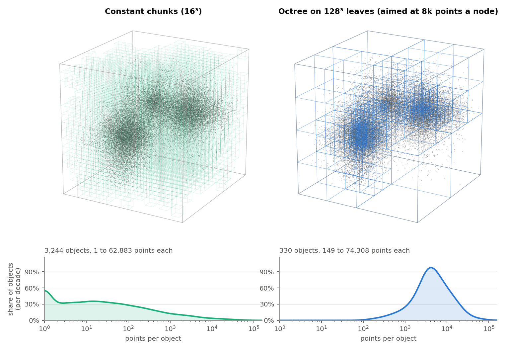
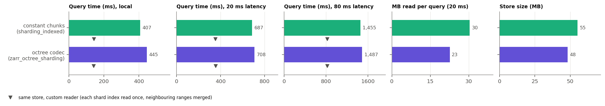

# zarr-octree

Zarr stores every chunk of its regular grid as a separate object, so object
sizes follow the density of the data: thousands of near-empty objects in
sparse regions, huge ones in dense regions.  zarr-octree groups neighbouring
chunks, along an octree's Z-order, into objects of bounded size, without
changing the chunk grid zarr sees.  It is a sharding codec, `octree_sharding`, that
unmodified zarr-python (3.2 or later) loads through its codec entry point.
The format is specified in
[`registry/codecs/octree_sharding/README.md`](registry/codecs/octree_sharding/README.md), the
codec's proposed entry in the Zarr extensions registry.  Built for point clouds in zarr-vectors
(option 1 of AllenInstitute/zarr-vectors-py#45).

## Octree against constant chunks



With constant chunks, every chunk is an object however many points it holds:
here 3,244 objects of 1 to 63k points.  An octree splits a node into eight
only where its children come closer to a target size (8k points) than the
node itself, so a node covers a large volume where the data are sparse and a
small one where they are dense, and empty space costs nothing: 330 objects,
93 % of them within a decade of the target.  zarr-octree goes one step further
and cuts the octree's Z-order into **runs** between a minimum and a maximum
size, which also merges the small nodes an octree leaves beside dense ones.
(Synthetic points: three clusters with broad tails, 2.27 M points;
`bench/figures_concept.py`.)

## Results



3.99 M synthetic points written through zarr-vectors and read through zarr's
API: geometric mean over 10 query types (boxes and objects), 16³-cell shards,
100 MB/s per request.

* **Through zarr, the codec is within 2–9 % of constant chunks on speed**
  (708 against 687 ms at 20 ms latency), **reads 26 % fewer bytes** per query
  and makes a **12 % smaller store** — its sparse index is 6 bytes per stored
  chunk against 16 bytes per possible chunk.
* **Objects are even** (figure above): the octree's object sizes vary 4×
  less than constant chunks' (CV 1.2 against 4.8), and the codec's runs are
  bounded at both ends.
* **A custom reader (▼) is where speed comes from**: reading each shard index
  once and merging neighbouring byte ranges halves query time at 20 ms
  latency, on either format.  It is a reader change, not a format change
  (prototyped in zarr-vectors).

So the codec is worth having for **store size** and for consumers that work
in **bounded units** (GPU batches, BRIDGE graphs: `read_runs`), not as a
speed-up on its own.  Every benchmark, figure and number is in
[`bench/RESULTS.md`](bench/RESULTS.md).

## Using it

The codec (`pip install -e .`; anyone reading the array needs the package too
— without it zarr refuses the array as an unknown codec).  Python 3.12 or
later and zarr 3.2 or later:

```python
import zarr
from zarr.codecs import BytesCodec, ZstdCodec
from zarr_octree import OctreeShardingCodec

codec = OctreeShardingCodec(chunk_shape=(16, 16, 16), codecs=[BytesCodec(), ZstdCodec()],
                            target=100_000)                         # the default: octree nodes aimed at 100 kB
arr = zarr.create_array("data.zarr", shape=(256, 256, 256), chunks=(128, 128, 128),  # chunks = shard shape
                        serializer=codec, compressors=None, dtype="float32", fill_value=0)
arr[:] = ...                                   # any zarr reads and writes
```

`layout="octree"` (the default) groups inner chunks into the leaves of an
octree aimed at `target`, with no hard bound; `layout="runs"` cuts Z-order runs
between `min_weight` and `max_weight` instead.  Sizes are in encoded bytes, or
in any unit with a registered weigher (`register_weigher("vertices", fn)`, then
`unit="vertices"`).

## How the codec stores a shard

The array, its shards, inner chunks and keys are what `sharding_indexed`
gives; only the bytes inside a shard differ (format in
[`registry/codecs/octree_sharding/README.md`](registry/codecs/octree_sharding/README.md)):

* inner chunks in Z-order, contiguous, grouped into runs: octree nodes aimed
  at `target` (default), or Z-order runs bounded by `min_weight` / `max_weight`;
* a **sparse index**: one row per stored chunk (a Z-order code and a length;
  offsets are implied) plus the run table, fetched with one suffix read;
* partial reads fetch **one byte range per run touched**; `read_runs` hands
  whole runs to consumers that want bounded units.

## Status

* Proposed for the Zarr extensions registry as `octree_sharding`; the format is
  frozen at index version 3.  Stores written by zarr-octree 0.3 and earlier
  (codec `zarr_octree_sharding`, index version 2) still read; nothing writes
  them any more.
* 78 tests (`pytest`), passing on zarr 3.2.1 and 3.4.2; CI tests the oldest
  supported zarr and the newest.  The codec subclasses zarr's `ShardingCodec`
  and uses some of its private internals, so new zarr releases need testing.
* A reader checks every index before using it (sorted codes inside the shard,
  a consistent run table, lengths that fit); a bad index is a `ValueError`.
* zarr-vectors uses it (`Layout(octree=...)`, `sharding.set_octree`).
* Not done: concurrent writers to one shard, tests on real object stores.

## Files

```
src/zarr_octree/codec.py       the octree codec
src/zarr_octree/tree.py        Morton codes and the two run partitions
src/zarr_octree/instrument.py  counting / latency store for tests and benchmarks
tests/                         pytest
bench/make_points.py           the synthetic densMAP point cloud
bench/bench_zv.py              the codec through zarr-vectors; figures_zv.py draws it
bench/figures_concept.py       the figure above
bench/bench_registry.py       octree against sharding_indexed (also in Z-order), through zarr alone
bench/RESULTS.md               every benchmark and number
registry/codecs/octree_sharding/        the format: the registry entry (README.md, schema.json, example.zarr)
registry/make_example.py       writes example.zarr and its annotated hex dump
```
