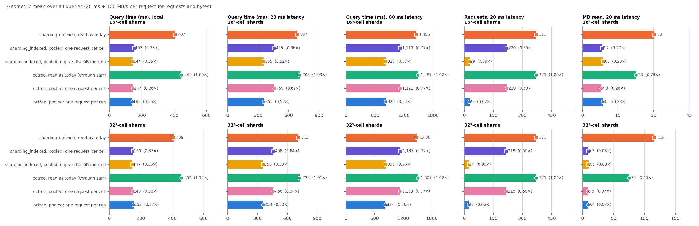

# zarr-octree: detailed results

The record behind the [README](../README.md).  All data are synthetic: the
3.99 M-point densMAP cloud from `bench/make_points.py`.

Earlier versions of this repository also held a store extension
(`OctreeStore`: octree nodes and a manifest as separate objects, formats 1
and 2) with its own benchmarks.  It was dropped in 0.3.0 in favour of the
codec, which needs no change to zarr; it is in the git history up to commit
`f626df8`.

## The codec

`octree_sharding` (named `zarr_octree_sharding` before 0.4, when these benchmarks
were run) replaces `sharding_indexed`, so zarr-python needs no
change: it finds the codec through the `zarr.codecs` entry point, and a reader
without it refuses the array (unknown codec).  The array, its shards, inner
chunks and keys are what `sharding_indexed` gives; only the bytes inside a
shard differ (format in
[`registry/codecs/octree_sharding/README.md`](../registry/codecs/octree_sharding/README.md)):

* a **sparse index**, one row per stored inner chunk (6 B up to 32³ chunks per
  shard), instead of the dense one (16 B per *possible* inner chunk); a reader
  gets it with one suffix read;
* inner chunks in Z-order, grouped into **runs**: octree leaves aimed at a
  target (`layout="octree"`, the default) or Z-order runs between a minimum
  and a maximum weight (`layout="runs"`);
* partial reads fetch **one byte range per run touched**, concurrently;
  `read_runs` hands whole runs to a consumer that wants bounded units.

It subclasses zarr's `ShardingCodec`, so `Array.shards`/`chunks` and code on
zarr's sharding API work unchanged.

**In zarr-vectors** (AllenInstitute/zarr-vectors-py, `octree` branch):
`Layout(octree=...)` marks a store so every sharded array it allocates uses
this codec, `sharding.set_octree` converts an existing store, and
`ZARR_VECTORS_SHARD_READER` picks the shard reader (`optimised` reads each
shard index once and coalesces ranges, on either codec).

## Against `sharding_indexed`, through zarr alone

`bench/bench_registry.py` (results: `results/bench_registry.json` and
`.log`), the comparison for the registry proposal.  2 M clustered points
binned into a 128³ grid of cells, one `bytes` inner chunk a cell (float32
xyz, zstd), shards of 16³ cells.  The same chunks in three stores:
`sharding_indexed` as zarr writes it, the same shards with their chunks
rewritten into Z-order (still `sharding_indexed`), and `octree_sharding` (default
layout, leaves aimed at 100 kB).  Box queries through `zarr.open_array`
behind `CountingStore` (20 ms, 100 MB/s a request), zarr-python 3.4.2;
medians over 10 boxes centred on random points:

| store | size | index | 8³ box: requests / MB / ms | 32³ box: requests / MB / ms |
| - | - | - | - | - |
| `sharding_indexed` | 64.0 MB | 33.6 MB | 4 / 0.66 / 121 | 53 / 5.73 / 4,952 |
| `sharding_indexed`, Z-order | 64.0 MB | 33.6 MB | 4 / 0.59 / 121 | 53 / 5.54 / 5,990 |
| `octree` | 33.1 MB | 2.7 MB | 8 / 0.36 / 113 | 78 / 4.35 / 4,749 |

* **The sparse index halves the store** (the dense index is 52 % of the
  `sharding_indexed` store) and **a query reads a quarter less**.
* **Query times are similar.**  zarr-python 3.4 batches nearby ranges of a
  `sharding_indexed` shard into few requests; the codec's reader makes one
  request per run touched, so on large boxes it makes more requests.
  Merging adjacent runs into one request is a possible reader improvement.
* **Z-order placement alone changes nothing through zarr.**  A reader merging
  adjacent wanted chunks would need about as many ranges either way (925
  against 915 for a 32³ box); the gain is the index.

On **zarr-python 3.2.1** (the quick run: 300 k points, 3 boxes a size), zarr
fetched every inner chunk of a `sharding_indexed` shard with its own request:
8,743 requests and 50 s for a 32³ box, against the codec's 53 requests and
2.9 s.  That gap closed in zarr 3.4.

## Reading through zarr-vectors

`bench/bench_zv.py` (figures: `bench/figures_zv.py`) writes the 3.99 M
densMAP points through zarr-vectors (64³ cells, zstd; objects of ~1,000
vertices), sharded 16³ or 32³ cells per shard by either codec (runs
160–640 kB), and reads boxes and objects through zarr-vectors' API — locally,
and behind the latency store (20 / 80 ms + 100 MB/s per request) — with six
readers.  Every reader returns the same points for every query.

Geometric mean over the 10 query types (ms; requests and MB at 20 ms), 16³-cell shards
(32³ within a few % of these, except today's dense-index reads: 116 MB):

| reader | local | 20 ms | 80 ms | requests | MB |
|---|---:|---:|---:|---:|---:|
| `sharding_indexed`, read as today | 407 | 687 | 1,455 | 371 | 30.4 |
| `sharding_indexed`, pooled, one request per cell | 153 | 456 | 1,119 | 220 | 8.2 |
| `sharding_indexed`, pooled, gaps ≤ 64 KiB merged | 144 | **355** | **823** | 29 | 8.6 |
| octree, read as today (through zarr) | 445 | 708 | 1,487 | 371 | 22.6 |
| octree, pooled, one request per cell | 147 | 459 | 1,121 | 220 | 7.9 |
| octree, pooled, one request per run | **142** | **355** | **825** | 28 | 8.5 |

| | `sharding_indexed` 16³ | octree 16³ | `sharding_indexed` 32³ | octree 32³ |
|---|---:|---:|---:|---:|
| store size (MB) | 55.1 | **48.2** | 56.1 | **48.2** |
| vertex shards (MB) | 44.5 | **41.1** | 45.0 | **41.1** |
| write (s) | 43.4 | 45.7 | 49.5 | 48.9 |

* **The reader is where the time goes, not the shard format.**  Reading each
  shard index once (the pooled reader) cuts query time 2.7× locally and 1.5×
  at 20 ms; letting neighbouring cells share a request cuts it to half of
  today at 20 ms and 0.57× at 80 ms — 13× fewer requests.
* **Octree runs as the unit of a read match, but do not beat, coalescing chosen
  by the query** on `sharding_indexed` (355 vs 355 ms at 20 ms, 825 vs 823 at
  80 ms; per query 0.97–1.09× at 20 and 80 ms, 0.82–1.19× locally).  `sharding_indexed` already stores inner
  chunks in Z-order, so merging near neighbours finds the same locality the
  runs encode; the runs' bound only caps what one request reads.
* **The octree codec still buys disk:** −12 % store size (the index is 6 B per
  stored chunk instead of 16 B per possible one), and it reads fewer bytes
  per query (read as today at 32³: 75 vs 116 MB, as zarr re-reads the index
  for every cell).
* So for zarr-vectors the speed is in the reader change, which works on
  today's format; the octree codec is worth having for size (sparse shards
  most), and for consumers that want **bounded** units — `read_runs`, the
  BRIDGE graph argument — rather than for faster box or object queries.

`bench/results/figures/zv_readers.png` (from `bench_zv_readers.json`) compares
the octree and runs layouts read through zarr's API and through zarr-vectors'
optimised reader.

## Not done yet

Concurrent writers to one shard (a partial write rewrites the whole shard);
object-store tests on real S3/GCS rather than injected latency; compressing a
run as a whole (each inner chunk is still its own zstd frame).
